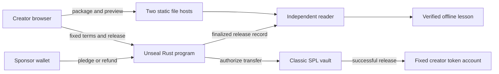

# Unseal architecture and delivery plan

Historical Phase 1 plan. The [approved implementation context](context/README.md) supersedes provisional product, interface and licensing choices here. Use the [Phase 1 record](phase-1-status.md) for existing implementation evidence.

23 November 2026. Phase 1 implementation started. Choices below assume a browser entry for the overall track and devnet test funds. Resource working title: **Your first internship application**, a short English learning pack for Ethiopian university students using original writing and illustrations. This is a reversible editorial choice. Initial pack is builder-authored and clearly labeled. Final public license and content review must be recorded before release.

## Technology choices

| Layer | Choice | Reason and boundary |
|---|---|---|
| Frontend | React + TypeScript + Vite, mobile-responsive | Static publishing keeps the reader portable and supports distinct campaign and reader origins. Lock exact versions when this phase begins. |
| Design | Instrument Sans for controls/body, Instrument Serif for editorial titles; ivory, charcoal, forest green, restrained terracotta | Treat the resource like a useful publication. Large touch targets, visible focus, readable contrast and reduced-motion support. |
| Wallet/client | Anchor TypeScript 1.2.2 with compatible web3.js v1 and a browser wallet | Match generated IDL and Rust program. Request signatures only for sponsor/creator actions. Readers need no wallet. Verify actual package compatibility at integration. |
| Backend | Original Rust Anchor program, anchor-lang/anchor-spl pinned 1.2.2 | Funding, deadlines, fixed recipient and refund rights execute on Solana. The application server has no custody. |
| Database | Solana Campaign and Receipt accounts for authoritative funding state | A conventional SQL service adds no necessary role in the MVP. Local browser storage may cache verified reading material and pending signatures, never establish payment finality. |
| File storage | Two static HTTPS origins serving identical encrypted bytes, immutable manifest and public preview | Content hashes verify identity across hosts; availability still depends on storage or cached copies. IPFS optional after the core works. |
| Encryption/identity | Native Web Crypto AES-256-GCM and SHA-256; js-multiformats 14.0.6 raw CID | Standard cryptography. Authenticated context binds pack to campaign. The reveal value is unrelated to wallet credentials. |
| Network | Solana devnet; one classic SPL test mint with no freeze authority | Test units visibly labeled. Fees and account rent require devnet SOL. No real-value claim. |
| Tests | Native Rust boundary tests, compiled SBF transactions in LiteSVM, then browser/devnet smoke | Host tests cannot demonstrate PDA-authorized money movement. Final checks need the actual compiled binary and signatures. |
| Build | Cargo workspace and lockfile; Linux SBF toolchain via WSL or another supported Linux environment | Windows native Rust checks can run independently. Record actual CLI and platform-tools versions before publishing deployment evidence. |
| Hosting | Static HTTPS hosting for campaign and an independently reachable reader | Hosting provider selected at integration. Production deployment requires Dexter's specific approval under global rules. |
| Git | Small Conventional Commits on short-lived branches, reviewed pull requests, recorded checks | Initial plan PR is #1; Phase 1 branch is feat/campaign-core. Preserve focused commits and resolve dependent PRs in order. |

## Data flow

## Program contract

- Campaign address derives from creator and a unique nonce. Account records immutable terms, mint, creator, pledged/refunded totals, status and published material.
- Vault derives from campaign and is controlled by the campaign PDA. Unexpected donated tokens do not increase recorded funding.
- One persistent receipt per campaign and sponsor records cumulative contributions and whether refunded.
- `create_campaign` checks positive target, ordered future deadlines and no mint freeze authority. Creates vault and terms.
- `pledge` checks signer, mint, source ownership, amount and exact cap before checked transfer. The contribution that reaches target locks the campaign in Filled.
- `release` validates the domain-separated material commitment before moving exactly target to a token account owned by the fixed creator. It records material in the same successful transaction. A relayer can pay fees; it cannot substitute itself as recipient.
- `refund` checks the correct timeout branch and pays each recorded sponsor once. Anyone may relay a refund to the recorded sponsor's token account. No sponsor must wait for the others.
- Funding accepts `now < fund_by`. Funded release accepts `now < reveal_by`. Refund opens at the relevant deadline, avoiding overlapping rights. Terminal accounts remain readable.

## Screens

| Screen | Main purpose | Key states |
|---|---|---|
| Campaign | Understand the resource, author, preview, rights and funding promise | Funding, fully funded awaiting release, released, expired |
| Sponsor | Choose contribution, review recipient/deadlines and sign | Disconnected, signing, pending, finalized, rejected, recoverable |
| Creator | Prepare file, publish fixed terms and release a funded pack | Draft, ready, funding, releasable, released or defaulted |
| Independent reader | Verify file and open released material with no wallet | File absent, waiting, verifying, readable, altered file, offline cached |
| Contribution receipt | Recover outcome and reclaim an expired contribution | Contributed, refunded, unavailable, pending confirmation |

The generated board is a concept with illustrative data. Implementation and accessibility checks will refine it. Exact lesson text and creator identity must be real and clearly credited before the demo.

## Phase gates

| Phase | Deliverables | Exit condition |
|---|---|---|
| 0 — Product | Name, audience, goal and recommended learning-pack direction approved | Completed; record editorial and license choices as they become concrete |
| 1 — Core proof | Rust handlers, fixed accounts, native tests, SBF build and runtime tests, devnet success/refund | Actual original-program token movements and replay rejection |
| 2 — Artifact and reader | Packager, manifest, two copies, wallet-free independent reader | Fresh reader opens verified cached file without campaign origin |
| 3 — Product UI | Campaign, sponsor, creator and receipt flows, responsive layout | Real wallet journey and finalized-state recovery |
| 4 — Verification | Adversarial accounts, deadline boundaries, tampering, duplicate claims, fresh browsers | Recorded test results and known trust assumptions |
| 5 — Submission | Public docs, address, IDL, receipts, live links, short video and entry | Ready Nov 29 at 08:00 EAT; actual lock minute unverified |

## Judging evidence

| Published signal | Evidence we must supply |
|---|---|
| Product clarity and impact | One named learner problem, visible preview and actual usable lesson; record real feedback only when obtained |
| Demo quality | Final sponsor, creator release, unrelated nonpayer opening file and a separate refund in under three minutes |
| Original Rust/Solana depth | Inspectable state rules, PDA custody, correct account constraints and failure tests |
| Deployment | Actual devnet program ID and transactions with independently checked balances |
| Repository quality | Locked dependencies, setup/test instructions, focused commits, reviewed PRs and upstream notices |
| Founder-market fit and live verification | Honest authorship/user evidence, limitations, and a fresh reader/wallet walkthrough |

Official judging has no verified numerical weights. Native mobile awards require additional Android/store scope. No claim of satisfying deployment or live-demo criteria until tested. Source: https://hack.dev3pack.xyz/faq and authenticated prize requirements at https://app.dev3pack.xyz/hackathon/member/dashboard/prizes.

## Material limits

Broadcasting material may disclose the file before payout succeeds. Creator controls usefulness and rights. Mirrors can disappear. Funding rules do not certify quality. Public devnet is for demonstration and upgrade authority remains a disclosed trust assumption. Current program ID is a development placeholder until a dedicated deployment identity is established.
