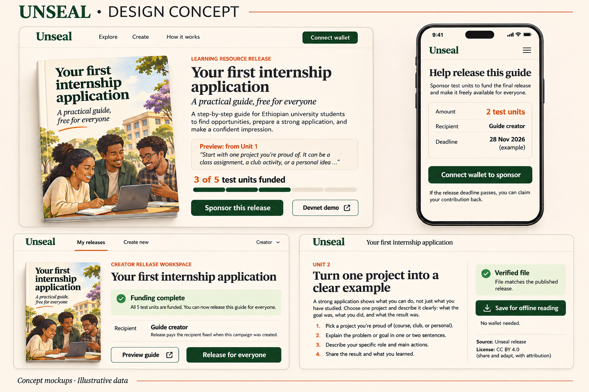

# Screen concept

Generated visual proposal, 23 November 2026. The four panels show campaign detail, mobile sponsorship, creator release and independent reading. Amounts, dates, author, license and content are illustrative. Final screens must read live campaign terms, identify the actual author and use the chosen resource's actual public license. The source pack is a provisional English internship-application guide.

Use warm ivory surfaces, dark text, forest-green actions and a small terracotta accent. Instrument Sans handles body and controls; Instrument Serif handles publication titles. Implement readable contrast, keyboard focus, 44px or larger primary tap areas and reduced motion. File verification means published bytes match; it does not certify educational quality.
